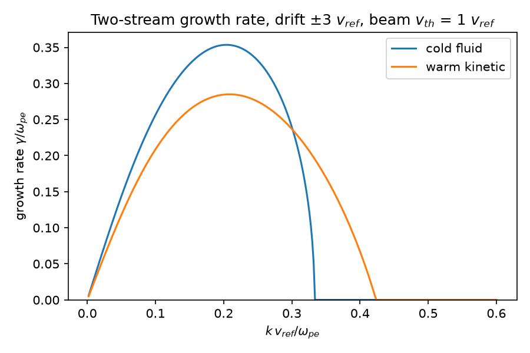

# twostream

Growth rates of the electrostatic two-stream instability, from a cold-fluid
and a warm-kinetic (Maxwellian) dispersion relation.

When two streams of electrons move through each other, small electric-field
ripples can grow exponentially, and the beams' energy is turned into wave
energy. This is the two-stream instability. The code finds how fast a ripple
of a given wavelength grows, first treating the electrons as perfectly cold
and then including their random thermal motion. Thermal motion lowers the
peak growth rate and widens the range of unstable wavelengths: for the example below the
cold model is stable above K = 1/3, the warm kinetic model up to K = 0.424.

The figure is produced by the code (`python -m twostream`) for two equal
beams with drift ±3 and thermal speed 1 (speeds in units of a reference speed v_ref, here equal to the
thermal speed; wavenumber K in units of w_pe / v_ref; rates in units of w_pe):

| model | max growth rate | at K |
|---|---|---|
| cold fluid | 0.3536 | 0.204 |
| warm kinetic | 0.2849 | 0.208 |

## Install and run

    python -m venv .venv && source .venv/bin/activate
    pip install -r requirements.txt
    python -m twostream --drift 3 --vth 1 --out docs/growth_rate.png
    pytest

Use it from Python:

    import numpy as np
    from twostream import scan, symmetric_two_stream

    species = symmetric_two_stream(drift=3.0, vth=1.0)   # [(a, u, vth), ...]
    K = np.linspace(0.01, 0.6, 200)
    omega_r, gamma = scan(species, K, model="kinetic")   # or "cold"

Species are tuples `(density fraction, drift, thermal speed)`, so unequal
densities and temperatures work too.

## Tests

`tests/` checks the cold model against the analytic result for two equal
beams (maximum growth rate 1/(2 sqrt 2) w_pe at K u = sqrt(3/8), stability
boundary at K u = 1), that the kinetic roots satisfy the dispersion relation, that the
warm marginal wavenumber matches the analytic value (below), that cold and kinetic roots also work for
three species, and that the kinetic result approaches the cold one for very cold beams.

At marginal stability (omega = 0) the symmetric warm dispersion relation gives
K_c^2 = 2 z D(z) - 1 with z = u / (sqrt(2) v_th) and D the Dawson function, which is
K_c = 0.4237 for drift 3 and thermal speed 1; `tests/` compares the solver with it.

## Limitations

- Electrostatic, 1-D, unmagnetised, Maxwellian electrons with fixed ions.
- The solver functions accept any number of species, but the helper `symmetric_two_stream` and
  the command line only build two equal, counter-streaming beams.
- Only the most unstable root is tracked. For the kinetic model it is found
  by Newton iteration and continued in K, which can fail near the stability
  boundary or for very hot beams. Failed points are returned as nan.
- Not compared against a particle simulation or experiment here.

## References

- B. D. Fried and S. D. Conte, *The Plasma Dispersion Function*, Academic
  Press (1961).
- F. F. Chen, *Introduction to Plasma Physics and Controlled Fusion*, Springer
  (two-stream instability).

## License

MIT, see `LICENSE`.
